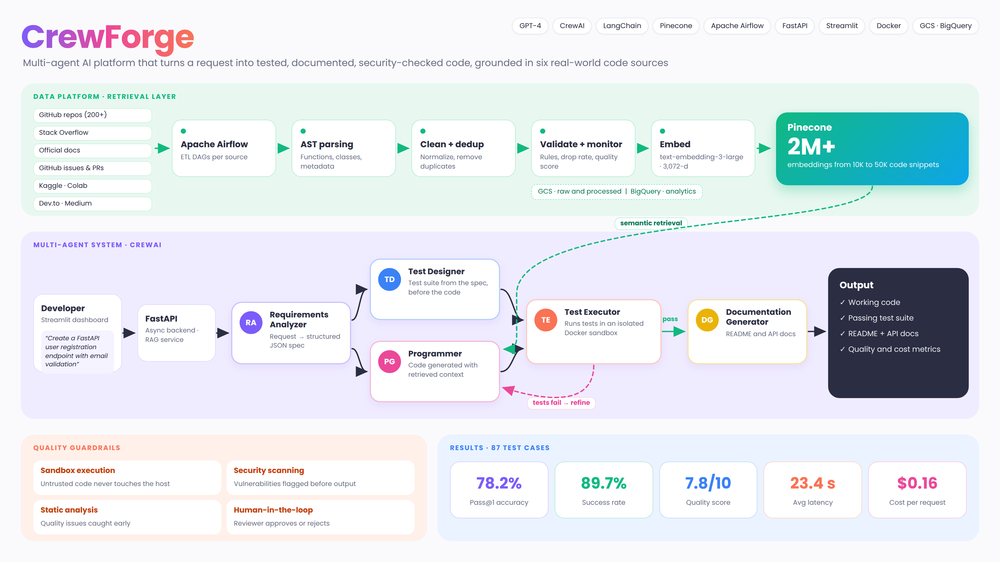
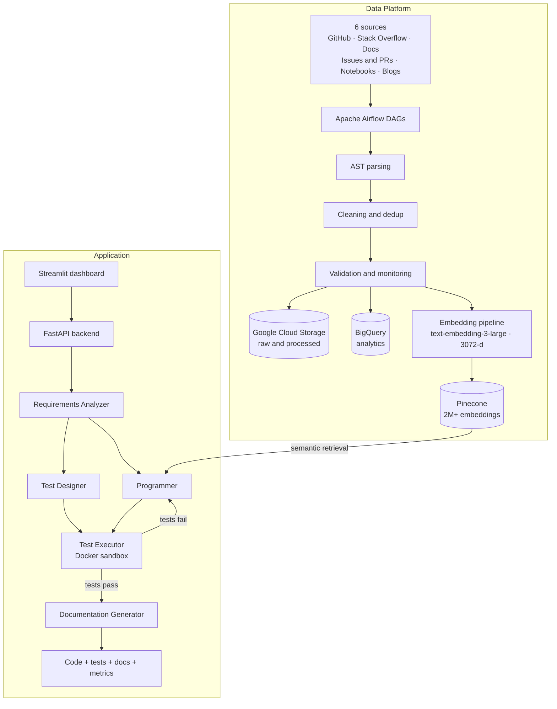

# CrewForge

**Multi-agent AI platform that turns a natural language request into tested, documented, security-checked code, grounded in a retrieval layer built from six real-world code sources.**

CrewForge (originally the Multi-Agent CodeGen AI Platform) combines a data platform and an agent system. An Airflow-orchestrated pipeline collects and cleans code from six sources, embeds it into Pinecone, and serves it through a RAG layer. Five specialized CrewAI agents then analyze the request, design tests, write code with retrieved context, execute the tests in a Docker sandbox, refine until they pass, and document the result.

> **Course:** DAMG 7245 – Big Data Systems & Intelligent Analytics, Northeastern University



---

## Table of Contents

1. [Results at a Glance](#results-at-a-glance)
2. [Key Features](#key-features)
3. [System Architecture](#system-architecture)
4. [Multi-Agent System](#multi-agent-system)
5. [Data Platform](#data-platform)
6. [RAG Layer](#rag-layer)
7. [Quality Guardrails](#quality-guardrails)
8. [Technology Stack](#technology-stack)
9. [Quick Start](#quick-start)
10. [Repository Structure](#repository-structure)
11. [Development](#development)
12. [Testing Strategy](#testing-strategy)
13. [Data Quality and Monitoring](#data-quality-and-monitoring)
14. [Design Decisions](#design-decisions)
15. [License](#license)

---

## Results at a Glance

Evaluated on 87 test cases:

| Metric | Result |
|---|---|
| Pass@1 accuracy | **78.2%** |
| Success rate | **89.7%** |
| Average quality score | **7.8 / 10** |
| Average latency | **23.4 s** per request |
| Cost per request | **$0.16** |

---

## Key Features

- **Five specialized agents:** Requirements Analyzer, Programmer, Test Designer, Test Executor, and Documentation Generator, orchestrated with CrewAI.
- **Design-first testing:** tests are designed from the specification in parallel with the code, not written after it.
- **Iterative refinement:** when tests fail in the sandbox, results flow back to the Programmer agent until the code passes.
- **Retrieval-grounded generation:** the Programmer agent pulls relevant snippets from a Pinecone index of 2M+ embeddings.
- **Six-source data platform:** Airflow DAGs collect from GitHub repositories, Stack Overflow, official documentation, GitHub issues and pull requests, notebooks, and technical blogs.
- **AST-based processing:** code is parsed, cleaned, validated, and deduplicated before it is embedded.
- **Layered guardrails:** security scanning, static analysis, human-in-the-loop review, and sandboxed execution.
- **Full stack delivery:** FastAPI backend with a Streamlit dashboard for generation and monitoring.

---

## System Architecture



The platform follows a modular pipeline design:

| Layer | Responsibility |
|---|---|
| Data ingestion | Airflow-orchestrated ETL from six sources |
| Processing | AST parsing, code cleaning, validation, and deduplication |
| Storage | Google Cloud Storage for raw and processed data, BigQuery for analytics, Pinecone for vectors |
| RAG | FastAPI service providing semantic retrieval |
| Agents | CrewAI-orchestrated agents for coordinated code generation |
| Guardrails | Security scanning, static analysis, human-in-the-loop review, sandbox execution |
| Interface | Streamlit dashboard for generation and monitoring |

---

## Multi-Agent System

### Workflow

```
User request
  → Requirements Analyzer (structured JSON specification)
      ├─ Test Designer   → test suite
      └─ Programmer      → code, using RAG context
  → Test Executor (Docker sandbox)
  → Iterative refinement until tests pass
  → Documentation Generator
  → Output: code + tests + docs + metrics
```

### Agent Roles

| Agent | Input | Output |
|---|---|---|
| Requirements Analyzer | Natural language request | Structured JSON specification |
| Test Designer | Specification | Comprehensive test suite, designed before the code |
| Programmer | Specification + retrieved snippets | Code grounded in real examples |
| Test Executor | Code + test suite | Results from an isolated Docker sandbox, fed back on failure |
| Documentation Generator | Passing code | README and API documentation |

---

## Data Platform

### Sources

| Source | What it contributes |
|---|---|
| GitHub repositories (200+) | High-quality open-source implementations |
| Stack Overflow | Curated questions and answers with code |
| Official documentation | Python, FastAPI, Django, and Flask |
| GitHub issues and pull requests | Real-world problem-solving patterns |
| Code examples | Kaggle notebooks and Google Colab |
| Technical blogs | Dev.to and Medium articles |

### Flow

```
Sources → Airflow ETL → AST parsing → Code cleaning → Validation and monitoring
        → Embedding pipeline → Pinecone → RAG retrieval → Agent orchestration → Output
```

Between 10K and 50K code snippets are processed, then embedded with OpenAI `text-embedding-3-large` (3,072 dimensions), using batch processing to control cost.

---

## RAG Layer

- FastAPI backend exposes semantic retrieval over the Pinecone index
- The Programmer agent receives the most relevant snippets as context before generating code
- Retrieval outputs are stored under `data/rag_outputs/` for inspection

---

## Quality Guardrails

| Guardrail | Purpose |
|---|---|
| Docker sandbox execution | Runs generated code and tests in isolation from the host |
| Security scanning | Flags vulnerabilities in generated code |
| Static analysis | Catches quality and correctness issues before execution |
| Human-in-the-loop review | Lets a reviewer approve or reject output |
| Iterative refinement | Failed tests return to the Programmer agent instead of shipping broken code |

---

## Technology Stack

### AI Engineering
| Area | Technology |
|---|---|
| LLM | OpenAI GPT-4 |
| Agent orchestration | CrewAI |
| LLM framework | LangChain |
| Embeddings | OpenAI text-embedding-3-large (3,072 dimensions) |
| Vector database | Pinecone (2M+ embeddings) |
| Retrieval | Retrieval-augmented generation |

### Software and Data Engineering
| Area | Technology |
|---|---|
| Backend | FastAPI (async Python) |
| Frontend | Streamlit |
| Orchestration | Apache Airflow |
| Code processing | Python AST parsing |
| Storage | Google Cloud Storage, BigQuery |
| Testing | Docker sandbox, pytest, security scanning |

---

## Quick Start

### Prerequisites
- Python 3.11+
- Docker Desktop (for sandboxed test execution)
- OpenAI API key
- Pinecone account (free tier available)

### Installation

```bash
git clone https://github.com/DhanvardiniRajendran25/CrewForge.git
cd CrewForge

python3 -m venv venv
source venv/bin/activate        # Windows: venv\Scripts\activate
pip install -r requirements.txt

cp .env.example .env
# OPENAI_API_KEY=your_key
# PINECONE_API_KEY=your_key
# PINECONE_ENV=your_environment
```

### Run

```bash
# Backend API
uvicorn src.backend.main:app --reload --host 0.0.0.0 --port 8000

# Frontend (separate terminal)
streamlit run src/frontend/app.py
```

### Try These Requests
- "Create FastAPI user registration endpoint with email validation"
- "Build file upload handler with size validation"
- "Generate REST API for managing todo items with SQLAlchemy models"

---

## Repository Structure

```
.
├── dags/                       # Airflow DAG definitions
│   ├── github_collection_dag.py
│   ├── stackoverflow_collection_dag.py
│   ├── documentation_collection_dag.py
│   └── embedding_generation_dag.py
├── src/
│   ├── agents/                 # The five agents + orchestrator and prompts
│   ├── backend/                # FastAPI backend
│   ├── embeddings/             # Embedding pipeline
│   ├── etl/                    # Data collection and ETL
│   ├── frontend/               # Streamlit UI
│   └── rag/                    # Retrieval system
├── bigquery/                   # BigQuery integration
├── docker/                     # Docker configuration
├── data/                       # Raw, processed, and RAG outputs
├── docs/                       # Architecture diagram
├── tests/                      # Unit and integration tests
├── cloudbuild.yaml             # Cloud Build configuration
├── requirements.txt
└── README.md
```

---

## Development

```bash
uvicorn src.backend.main:app --reload          # backend only
streamlit run src/frontend/app.py              # frontend only
python src/etl/github_collector_expanded.py    # data collection
python src/embeddings/generate.py              # embedding generation
pytest tests/ -v --cov=src                     # tests with coverage
```

---

## Testing Strategy

| Level | Scope |
|---|---|
| Unit | Individual functions and classes |
| Integration | Agent workflows and API endpoints |
| End to end | The complete generation pipeline |
| Performance | Latency and throughput benchmarking |

---

## Data Quality and Monitoring

**Validation rules**
- Required fields present: `snippet_id`, `code`, `language`
- Non-empty code blocks
- Valid function and class metadata
- Complexity within acceptable ranges

**Monitored metrics**
- Total snippets processed, valid snippets, and dropped snippets
- Drop rate percentage
- Quality score distribution
- Deduplication rate

---

## Design Decisions

| Decision | Chosen | Over | Why |
|---|---|---|---|
| Agent structure | Five single-purpose agents | One general agent | Each agent has one prompt and one job, which makes failures easier to trace |
| Test timing | Tests designed from the spec, in parallel with code | Tests written after the code | Tests check the requirement, not the implementation |
| Failure handling | Refinement loop back to the Programmer | Returning first-attempt code | Output has to pass its own tests before it ships |
| Execution | Isolated Docker sandbox | Running code on the host | Untrusted generated code never touches the host |
| Grounding | Retrieval over real-world code | Model knowledge alone | Generated code follows patterns from working projects |
| Embeddings | Batch processing | Per-snippet calls | Keeps embedding cost manageable at millions of vectors |

---

## License

This project is licensed under the MIT License. See the [LICENSE](LICENSE) file for details.
